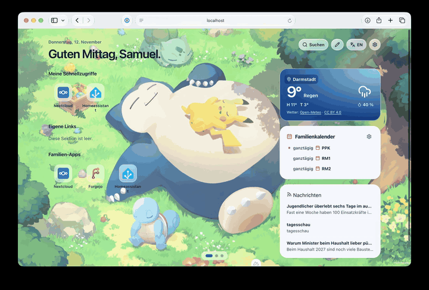

<div align="center">

# Heute

**Your family. Your apps. All in one place.**

A self-hosted start page with calendar, weather, news and personal shortcuts.




[](LICENSE)

[Try it](#view-it-locally) · [Docker](#run-with-docker-compose) · [GitHub build](#build-the-docker-image-with-github-actions) · [Usage rights](#license-and-usage-rights)

</div>

| For everyday use | For your homelab |
| --- | --- |
| Shared family apps and private links | OIDC sign-in with Pocket ID and group permissions |
| Personal pages and a widget library | SQLite and a persistent Docker volume |
| Calendar, weather and RSS news | Home Assistant, Open-Meteo and Nextcloud |
| Light and dark interface, custom backgrounds | Nuxt 4, Nuxt UI and Bun; designed for Safari on the Mac |

## License and usage rights

The project's own code is released under the [MIT License](LICENSE).
Images, icons, libraries and external services are additionally governed by the
[third-party notices](THIRD_PARTY_NOTICES.md).

## View it locally

```sh
bun install --frozen-lockfile
NUXT_PUBLIC_DEMO=true bun --bun run dev --host localhost
```

Open [localhost:3000](http://localhost:3000). The preview shows sample apps, weather and events. It works with sample data and offers no write actions.

## Run with Docker Compose

1. Copy `.env.example` to `.env`. Set the public HTTPS address in `NUXT_APP_URL` and generate `NUXT_APP_SECRET` with `openssl rand -base64 32`. Keep the secret across updates.
2. In Pocket ID, create a confidential OIDC client with the callback URL `https://heute.example.net/auth/callback`. Enter the issuer, client ID and client secret. Enable the client for the family group. Members with admin rights also belong to the admin group. In the settings, use the claim names of both groups, for example `family` and `heute-admin`. The group assignment is reloaded at every sign-in. Sessions expire after eight hours.
3. Start the app with `docker compose up -d --build`. On the host it is reachable by default at `127.0.0.1:3000`. The `heute-data` volume holds links and favorites.
4. Forward the public domain in `cloudflared` to your NGINX. NGINX forwards to Heute. If NGINX runs in a container, use a shared private Docker network and the service name `heute:3000`. In that case remove the port mapping. NGINX and Cloudflare should not cache Heute responses.
5. Sign in with an admin account and create the shared links via **App**. **Link** creates a private shortcut. Shared apps can be pinned via the menu on the icon.

Example for an HTTPS vhost on the same host as Compose:

```nginx
location / {
    proxy_pass http://127.0.0.1:3000;
    proxy_set_header Host $host;
    proxy_set_header X-Forwarded-Proto https;
    proxy_cache off;
    client_max_body_size 64m;
}
```

For a backup, stop Heute briefly and back up the complete volume. On a restore, reuse the same OIDC settings so that personal entries remain mapped to the correct accounts.

## Import family apps from Pocket ID

In Pocket ID, create an API key under **Administration → API Keys** and set it in the server-side `.env` as `NUXT_POCKET_ID_API_KEY`. The key has the permissions of the issuing Pocket ID admin. Heute fetches the app list via the HTTPS address in `NUXT_OIDC_ISSUER`. After the configuration change, `docker compose up -d` recreates the container with the updated environment.

As an admin, open edit mode in Heute. In the desired family section, choose **Import from Pocket ID**, select the apps and confirm the selection. For an app to be selectable, it needs a **Client Launch URL** in Pocket ID under **Administration → OIDC Clients → General**. Heute imports the name and launch URL as an editable link. Pocket ID checks each person's access rights at sign-in.

## Build the Docker image with GitHub Actions

[The GitHub workflow](.github/workflows/docker-build.yaml) runs on pushes to
`main`, tags `v*`, pull requests to `main`, and manually via **Actions → Docker image → Run workflow**.
It runs on a GitHub-hosted Ubuntu runner and publishes using the automatically
provided `GITHUB_TOKEN`; no custom registry secrets are needed.

1. Production build with Bun and a pinned lockfile.
2. All tests and the Nuxt typecheck in the `checks` Docker target.
3. Start of the finished image without external network access and a check of `/api/health`.

After a successful healthcheck, the workflow publishes the verified linux-amd64 image
under `ghcr.io/<github-owner>/<repository>` (all lowercase):

- `:<commit-sha>` for every published state.
- `:latest` for pushes to `main` and manual runs on `main`.
- `:<git-tag>` for tags such as `v0.4.1`; tag builds do not overwrite `latest`.

Pull requests build and verify only. Manual runs on other branches also publish
nothing. The job requires `packages: write`. For an existing GHCR package, the
repository must have Actions write access there. The package visibility is managed
separately in GitHub; a public repository does not automatically make the container
package public.

The existing Forgejo pipeline remains responsible for the Forgejo registry.
The same flow can be prepared locally:

```sh
docker build --target checks -t heute-checks .
docker build -t heute:local .
```

The image runs as the user `bun`. License texts are located under
`/app/licenses/`; the package inventory under `/app/licenses/dependencies/packages.json`.

## Develop and verify

Bun **1.4.4** is pinned in `packageManager` and in the Dockerfile.

```sh
bun install --frozen-lockfile
bun test
bun --bun run typecheck
bun --bun run build
bun scripts/collect-licenses.mjs
```

Configuration: [.env.example](.env.example) · Changes: [CHANGELOG.md](CHANGELOG.md)

## Build the Docker image with Forgejo Actions

The workflow in `.forgejo/workflows/docker-build.yaml` runs on pushes to `main`, on tags such as `v1.0.0`, and on manual start. Use a dedicated runner for this trusted repository with the label `docker-build`.

The runner runs as a container with `code.forgejo.org/forgejo/runner:13`, gets `/var/run/docker.sock` mounted and uses `ghcr.io/catthehacker/ubuntu:act-22.04` as the job image. Its `config.yml` holds the job image and the socket forwarding:

```yaml
runner:
  labels:
    - docker-build:docker://ghcr.io/catthehacker/ubuntu:act-22.04
container:
  docker_host: unix:///var/run/docker.sock
```

The job image contains Node.js, Git and the Docker CLI. The runner forwards the Docker socket to its job containers so that `docker build`, `docker run` and `docker exec` run on the NAS Docker daemon. Jobs of this runner have full access to the Docker daemon. Use it only for this trusted repository and not for PR jobs from foreign forks. The regular `docker` runner for **Version and Changelog** stays without socket forwarding.

The workflow builds the image, checks `/api/health` in a container without external network access, and only then pushes it to the Forgejo package registry:

- `registry.example.net/owner/repository:<commit-sha>` on every run
- `:latest` on pushes to `main` and on tag builds
- `:<git-tag>` on tags such as `v1.0.0`

The Forgejo job summary shows the flow as a status-dependent Mermaid diagram: green = success, red = failed, gray = skipped. The diagram is generated directly in the workflow from the status values of the individual steps and adapts to the actual result.

The registry hostname (including any explicit port) is derived automatically from `FORGEJO_SERVER_URL`. The image path uses `FORGEJO_REPOSITORY` in lowercase. No manual registry variable is needed when using the built-in Forgejo registry.

For this, the repository needs the secret `REGISTRY_TOKEN` with package write permission (`write:package`). For private packages, pulling on the NAS requires `docker login registry.example.net`. Forgejo 17 shows the job summary with commit, tags and image digest above the logs; this requires Forgejo Runner 13.2 or newer.

Local builds leave the source URL label empty; optionally set it with `docker build --build-arg SOURCE_URL=https://git.example.net/owner/repository .`.

The Compose file can still build locally with `build: .` or be switched to `image: registry.example.net/owner/repository:latest`.

## Manually sync main to GitHub

The Forgejo workflow **Sync main to GitHub** (`.forgejo/workflows/sync-github.yaml`) runs only when manually triggered on `main`. It checks out the current Forgejo `main` and publishes its exact file contents as one new commit on top of GitHub `main`. Individual Forgejo commits are not transferred. GitHub-only file changes are overwritten by the snapshot, while existing GitHub history is preserved; other branches and tags are unchanged. If the file contents already match, no commit is created. Previously transferred history is not removed. If GitHub `main` changes during the sync, the push fails instead of overwriting that concurrent update. An empty destination repository is supported.

In the Forgejo repository's **Settings → Actions**, configure:

| Type | Name | Value |
| --- | --- | --- |
| Variable | `SYNC_USERNAME` | GitHub username used for authentication |
| Variable | `SYNC_REPOSITORY` | Destination as `owner/repository` |
| Secret | `SYNC_TOKEN` | GitHub personal access token with write access to the destination |

For a fine-grained token, grant the destination repository **Contents: Read and write** and **Workflows: Read and write**, since this repository includes GitHub Actions workflows. For a classic token, use `repo` and `workflow` scopes. GitHub branch protection/rulesets must allow this account to push directly to `main`. Each snapshot extends the existing GitHub history.

Open **Actions → Sync main to GitHub → Run workflow** and select `main`. The workflow uses the regular `docker` runner without Docker socket access. Credentials are supplied through a temporary askpass helper, never embedded in the remote URL or written into Git configuration. A successful push can trigger the destination's GitHub Actions, including the GHCR image build.

## Version and Changelog

With every change that reaches `main`, bump the version in `VERSION` and add the matching entry at the top of `CHANGELOG.md`, e.g. `## [0.1.5]`. The Forgejo job **Version and Changelog** compares the PR state with the current `main` on pull requests. It runs on a container runner with the label `docker`.

## Weather and Nextcloud

For weather, set the place name, coordinates and timezone in `.env`. The server calls Open-Meteo. A faulty or slow weather query does not block the launcher.

Set `NUXT_NEXTCLOUD_URL` to the public HTTPS base address of your Nextcloud, including any subpath. Generate a key with `openssl rand -base64 32` and set it as `NUXT_NEXTCLOUD_ENCRYPTION_KEY` in `.env`. Store the key separately from the SQLite volume. If the key is lost or the base address changes, the accounts must re-authorize Nextcloud.

**Search files** opens the Nextcloud device flow on first use. Signing in there can run through your Pocket ID connection. After authorizing, return to Heute and choose **Check connection**. Heute stores the Nextcloud username and the app password encrypted in the SQLite volume. The connection belongs to the dashboard account and is available in another browser after signing in again. Existing browser connections must be re-authorized once.

**Disconnect Nextcloud** removes the connection from Heute and tries to revoke the app password in Nextcloud. The app password can also be revoked in Nextcloud under **Settings → Security**. The search uses the file provider of the Nextcloud Unified Search.

## Calendar

The family calendar shows events from Home Assistant. It requires a running HA installation (at least 2026.10) with a working official iCloud integration and existing `calendar.*` entities.

Set in `.env`:

- `NUXT_HA_URL` – fixed HTTP(S) base address of your Home Assistant, without user info, query or fragment. It must be reachable from the Heute container, e.g. via a shared Docker network or a routable internal address.
- `NUXT_HA_TOKEN` – a long-lived HA access token. Only in `.env`/deployment secrets, never in the browser, logs or fixtures.

As soon as URL and token are set, the calendar is active. Heute loads the available calendars dynamically from Home Assistant (`/api/states`, filtered to `calendar.*`) and shows the display names (`friendly_name`). Each family member selects via the gear in the widget which calendars are shown; the selection is stored per account. Until the first selection, a hint appears in the widget.

Optional:

- `NUXT_HA_CALENDAR_IDS` – upper bound of allowed calendars (comma-separated, `calendar.[a-z0-9_]+`, at most 20). Empty means: all calendars found in HA are selectable. If set, only these are available.
- `NUXT_HA_REQUEST_TIMEOUT_MS` (1000–30000), `NUXT_HA_CACHE_TTL_SECONDS` (30–300) and `NUXT_HA_CALENDAR_TIMEZONE` (IANA zone, default `Europe/Berlin`).

In the widget settings you can also choose an icon per calendar and toggle the grouping by day. Since HA usually provides no color for calendars, the color is derived deterministically from the calendar ID (unless HA supplies a color). A completely empty HA configuration leaves the widget at the previous iCloud link; a partially set or invalid configuration leads to an error in the widget. Events are cached per calendar for up to 90 seconds, the list of calendars for about ten minutes. If the widget shows an error, check reachability, token and calendar entities via the server logs; error details are not sent to the browser.

## Safari

Under **Safari → Settings → General**, enter the HTTPS address as the homepage. Optionally select **New tabs open with → Homepage** and **New windows open with → Homepage**.

## Appearance

**Customize → Add image or video** uploads a personal background:

- JPEG, PNG or WebP: at most **8 MiB** and **24 megapixels**. Images are stored as WebP without metadata.
- MP4 or WebM: at most **64 MiB**. For Safari, MP4 with H.264 is recommended. The browser checks playability before upload; the server checks the container header and size. Videos are stored unchanged, not transcoded.
- On upload, the browser generates a small preview image (poster) that serves in the settings grid and as the loading preview of the background.
- One personal upload is kept per account. Replacing and removing deletes the previous file. Selecting a different background keeps the personal upload.
- Admins can additionally upload and delete **shared** images and videos for all accounts under **Customize**. An existing name is confirmed before replacing.
- Videos run muted in a loop and pause in inactive tabs. With "Reduce motion", the video stays paused.

Set at least `client_max_body_size 64m;` and a sufficiently long upload timeout
for `/api/appearance/image` and `/api/appearance/library` at the reverse proxy.
The app enforces the separate size limits even for uploads without `Content-Length`.

### Media folder and shared library

Media is stored as files next to the database. With the default Docker setup this results in:

```text
/data/
├── heute.sqlite            # Settings and mappings
└── media/
    ├── uploads/            # Personal files, managed by Heute
    └── library/            # Shared images and videos, filled by the admin
```

The existing Compose volume `heute-data:/data` contains **database and media**.
Additionally `./media/library` is mounted as a bind mount to `/data/media/library`,
so admins can conveniently place files directly from the host. For local operation
this corresponds to `data/media/`. With a different `NUXT_DATABASE_PATH`, `media/`
sits next to that database.

Admins can upload images and videos via the web interface or copy them directly into
the host folder `media/library`. Supported are `.jpg`, `.jpeg`, `.png`, `.webp`,
`.mp4` and `.webm`; subfolders, hidden files and symbolic links are not picked up.
The file name without extension becomes the title. The selection is reloaded when
opening the settings; a restart is not needed. Copy files first under a temporary
extension and then rename them, so that no half-finished videos are offered. Removed
or unplayable media falls back to the default background.

For the container to be able to write via the web interface, the host folder must
belong to the container user `bun` (UID/GID **1000**). Create it once and set the
permissions:

```sh
mkdir -p media/library
sudo chown -R 1000:1000 media/library
```

Personal uploads are only retrievable for the respective signed-in account,
library files for all signed-in accounts. There is no anonymous access to the
media routes.

The files in `uploads/` carry generated names; their account mapping stays in SQLite.
Therefore place your own files for the shared selection in **`library/`** and not in
`uploads/`. Library files are served unchanged, including any present metadata. Only
use media for which the necessary rights are held.

### Migration and backup

On the first database access after the update, Heute writes existing image BLOBs
to `uploads/` and updates the mapping. Only after a successful write is the
respective BLOB cleared. Back up the complete data volume before the update; for a
restore afterwards, restore **SQLite and the media folder together**.
The SQLite file does not shrink automatically when cleared; free space is reused.

The link editor and the Pocket ID import use the [selfh.st icon catalog](https://selfh.st/icons/) under [CC BY 4.0](https://github.com/selfhst/icons/blob/87a5dfd901a341e271eb453ffebce6c5a88c308e/LICENSE). The search index and the CDN URLs are based on [the same catalog state](https://github.com/selfhst/icons/blob/87a5dfd901a341e271eb453ffebce6c5a88c308e/index.json).

## RSS

Set a JSON list in `.env` with up to ten direct HTTPS addresses, for example
`NUXT_RSS_FEEDS='["https://example.org/feed.xml","https://example.net/atom.xml"]'`.
After `docker compose up -d`, all family accounts see the same news card. An empty
list hides it. Use the final feed address, since the server does not follow redirects.
